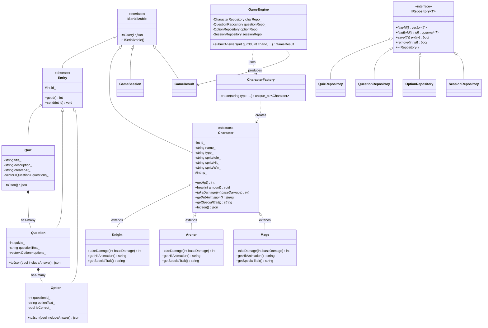

# Dokumentasi Penerapan Pemrograman Berorientasi Objek (OOP)
## Aplikasi Web "Quiz Game" - Backend C++17

Dokumen ini disusun sebagai panduan komprehensif dan bahan presentasi tugas kuliah mata kuliah **Pemrograman Berorientasi Objek (PBO)**. Seluruh arsitektur backend dirancang dengan menerapkan prinsip-prinsip desain berorientasi objek secara murni dan terstruktur.

---

## 1. Ringkasan Penerapan 6 Pilar OOP

| Konsep OOP | Implementasi di Proyek | Lokasi Kode Utama |
| :--- | :--- | :--- |
| **Class & Object** | Pemisahan deklarasi `.h` dan implementasi `.cpp` untuk setiap model, repositori, engine, dan database handler. | `backend/models/`, `backend/repositories/`, `backend/engine/` |
| **Enkapsulasi** | Seluruh atribut bersifat `private`/`protected`. Darah karakter (`hp_`) hanya dapat diubah melalui `takeDamage()` dan `heal()`. Kunci jawaban (`is_correct`) disembunyikan saat dikirim ke pemain melalui `Option::toJson(false)`. | `models/Character.h`, `models/Character.cpp`, `models/Option.h` |
| **Pewarisan (Inheritance)** | `Entity` diturunkan ke `Quiz`, `Question`, dan `Option`. `Character` diturunkan ke `Knight`, `Archer`, dan `Mage`. | `models/Entity.h`, `models/Knight.h`, `models/Archer.h`, `models/Mage.h` |
| **Polimorfisme** | Method virtual murni `getHitAnimation()` dan `getSpecialTrait()` di-override oleh tiap subclass dengan perilaku berbeda (`takeDamage()` juga virtual). Penggunaan `std::unique_ptr<Character>` dan `CharacterFactory`. | `models/Character.h`, `models/Knight.cpp`, `models/Archer.cpp`, `models/Mage.cpp`, `models/CharacterFactory.cpp` |
| **Abstraksi** | `GameEngine` menyembunyikan seluruh kerumitan kalkulasi penilaian, mitigasi damage, dan penyimpanan database dari Handler API. | `engine/GameEngine.h`, `engine/GameEngine.cpp` |
| **Interface** | Abstract class dengan pure virtual function (`= 0`) dan virtual destructor: `ISerializable` dan generic template `IRepository<T>`. | `interfaces/ISerializable.h`, `interfaces/IRepository.h` |

---

## 2. Diagram Kelas (Class Diagram - Mermaid)



---

## 3. Penjelasan Rinci Setiap Konsep OOP

### A. Class & Object
- **Pemisahan File**: Setiap konsep domain memiliki file header (`.h`) untuk deklarasi tipe dan file implementasi (`.cpp`) untuk logika eksekusi.
- **Constructor & Destructor**: Menggunakan constructor eksplisit dengan inisialisasi member (`initializer list`) serta virtual destructor pada seluruh base class/interface guna mencegah memory leak.

### B. Enkapsulasi (Encapsulation)
1. **Proteksi Darah Karakter (`hp_`)**:
   Atribut `hp_` dilindungi dalam `Character` (`protected`). Nilai `hp_` tidak boleh diubah secara sembarangan dari luar (misal: `player.hp = -999` dilarang). Nilai darah hanya bisa berubah melalui method:
   - `heal(int amount)`: Menambah darah dan menjaga nilainya tidak melampaui `100`.
   - `takeDamage(int baseDamage)`: Mengurangi darah dan menjaga nilainya tidak jatuh di bawah `0`.
2. **Keamanan Anti-Cheat Soal (`Option::toJson`)**:
   Atribut `isCorrect_` bersifat `private`. Pada method `toJson(bool includeAnswer)`:
   - Jika dipanggil untuk pemain (endpoint `GET /api/play/:quizId`), `includeAnswer` bernilai `false`, sehingga atribut `is_correct` **tidak pernah dikirimkan ke browser**.
   - Kunci jawaban hanya diakses di sisi server oleh `GameEngine` saat pemain mengirimkan seluruh jawaban pada endpoint `POST /api/submit`.

### C. Pewarisan (Inheritance)
1. **Hierarki Entitas**:
   Class abstrak `Entity` mendefinisikan identitas unik (`id_`) beserta getter/setter. Class `Quiz`, `Question`, dan `Option` mewarisi `Entity` sehingga tidak terjadi duplikasi kode atribut ID.
2. **Hierarki Karakter**:
   Class `Character` mendefinisikan atribut dasar seperti `name_`, `type_`, `hp_`, dan sprite animasi. Subclass `Knight`, `Archer`, dan `Mage` mewarisi atribut dan fungsi dasar ini.

### D. Polimorfisme (Polymorphism)
Besar damage ditentukan `GameEngine`: **100 ÷ jumlah soal** (dibulatkan ke atas) untuk setiap jawaban salah, sama untuk semua karakter. Contoh: kuis 1 soal = 100 damage (langsung kalah), 5 soal = 20 damage.
Perbedaan perilaku tiap karakter diwujudkan lewat method virtual murni `getHitAnimation()` dan `getSpecialTrait()` pada base class `Character`, yang di-override secara spesifik:
- **Knight (Ksatria Baja)**: animasi terkena serangan `"knight-shield-block"` (menahan dengan perisai).
- **Archer (Pemanah Elit)**: animasi `"archer-dodge-recoil"` (terpental ke belakang).
- **Mage (Penyihir Elemen)**: animasi `"mage-barrier-shatter"` (penghalang sihir pecah).

`takeDamage(int damage)` di `Character` bersifat `virtual` dengan implementasi umum (HP tidak pernah di bawah 0), sehingga subclass tetap dapat meng-override-nya jika di masa depan ingin aturan damage khusus.

**Factory Pattern**:
Subclass dibuat melalui `CharacterFactory::create(type, ...)` yang mengembalikan smart pointer polimorfik `std::unique_ptr<Character>`. Pemanggil (seperti `GameEngine` atau `CharacterRepository`) tidak perlu mengetahui class turunan konkret mana yang sedang aktif.

### E. Abstraksi (Abstraction)
`GameEngine` menyediakan abstraksi tingkat tinggi. API Handler pada REST server hanya perlu memanggil:
```cpp
GameResult result = engine.submitAnswers(quizId, characterId, playerName, userAnswers);
```
API Handler tidak perlu tahu bagaimana query database dijalankan, bagaimana kunci jawaban dicocokkan, atau bagaimana formula pengurangan HP dihitung untuk tiap karakter. Seluruh kerumitan logika tersebut diabstraksikan di dalam `GameEngine`.

### F. Interface (Pure Virtual Function)
1. **`ISerializable`**:
   Mendefinisikan pure virtual function `virtual nlohmann::json toJson() const = 0;`. Menjamin setiap class model dapat dikonversi ke format JSON untuk komunikasi REST API.
2. **`IRepository<T>`**:
   Mendefinisikan kontrak akses data CRUD standar:
   - `virtual std::vector<T> findAll() = 0;`
   - `virtual std::optional<T> findById(int id) = 0;`
   - `virtual bool save(T& entity) = 0;`
   - `virtual bool remove(int id) = 0;`
   Diimplementasikan oleh `QuizRepository`, `QuestionRepository`, `OptionRepository`, `CharacterRepository`, dan `SessionRepository`.

---

## 4. Panduan Menjawab Pertanyaan Dosen Saat Ujian / Presentasi

- **T: "Di mana letak polimorfisme di kode Anda?"**
  - **J**: "Di class `Character` pada method `getHitAnimation()` dan `getSpecialTrait()`. Saat `GameEngine::submitAnswers` dipanggil, engine memegang pointer `std::unique_ptr<Character>`. Ketika jawaban pemain salah, engine memanggil `character->takeDamage(damagePerWrong)` lalu mengirim `character->getHitAnimation()` ke frontend. Secara polimorfik, Knight menghasilkan animasi blok perisai, Archer terpental, dan Mage penghalang sihir pecah, padahal pemanggilnya sama persis."
- **T: "Bagaimana Anda mencegah pemain curang melihat kunci jawaban lewat inspect element?"**
  - **J**: "Dengan prinsip Enkapsulasi di C++. Pada endpoint `GET /api/play/:quizId`, method `Option::toJson(false)` dipanggil dengan parameter `includeAnswer = false`, sehingga atribut `is_correct` sama sekali tidak dimasukkan ke dalam response JSON. Evaluasi baru dilakukan di server C++ oleh `GameEngine` saat pemain melakukan submit."
- **T: "Mengapa menggunakan abstract class Entity dan interface ISerializable?"**
  - **J**: "Untuk menerapkan prinsip *Don't Repeat Yourself* (DRY) dan *Open/Closed Principle*. `Entity` mewariskan pengelolaan ID, sedangkan `ISerializable` memastikan standarisasi output data ke format JSON untuk seluruh entitas sistem."
